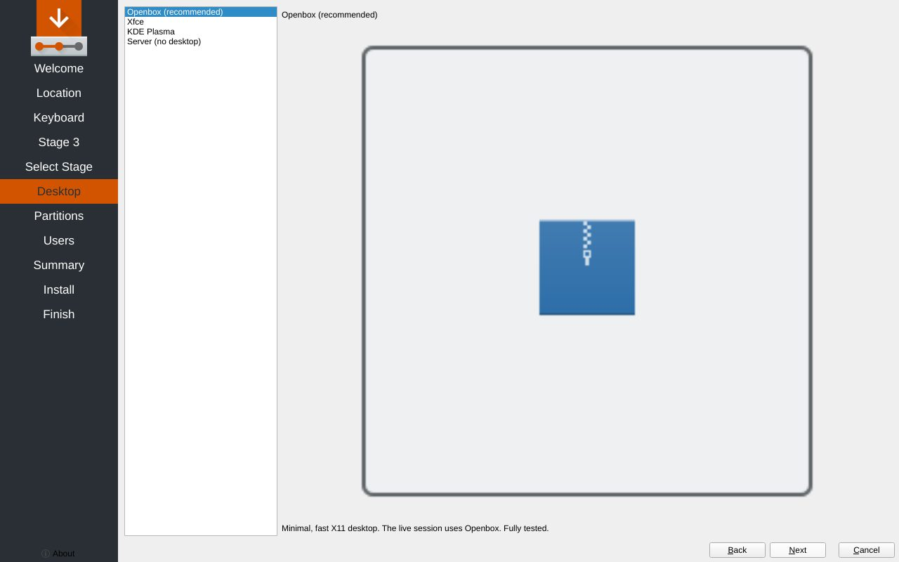
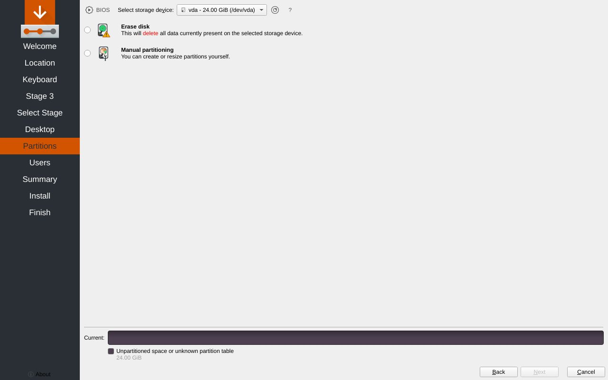
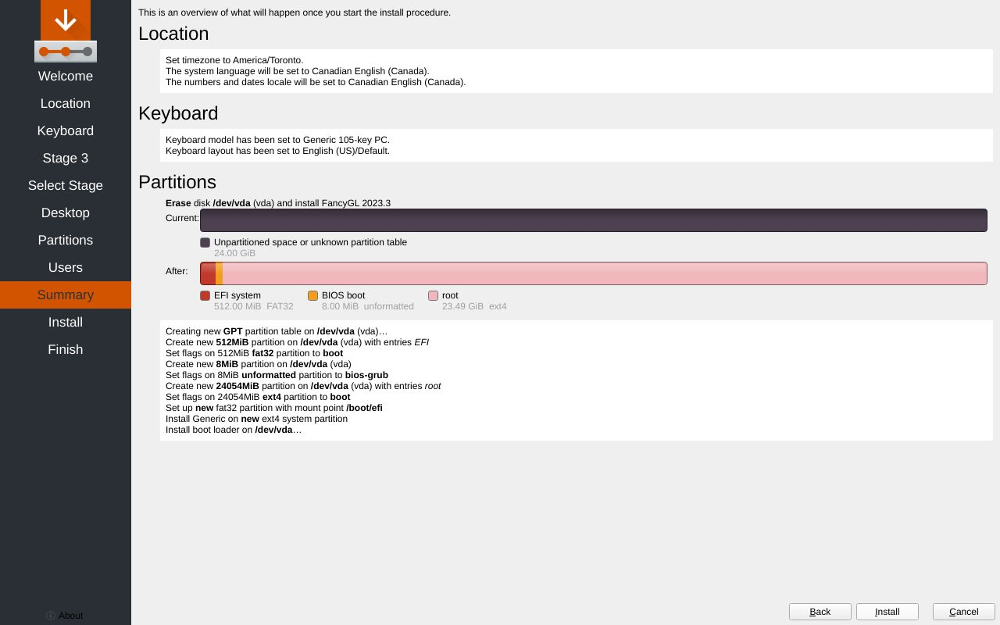

<p align="center">
  
</p>

<h1 align="center">Ember Linux</h1>

<p align="center">
  <strong>A Gentoo-based live ISO with a graphical installer.</strong><br>
  Pick a stage3, pick a desktop, pick a disk. Get a working Gentoo system.
</p>

<p align="center">
  <a href="https://github.com/Speaker300/ember-linux/actions"></a>
  
  
  
  
</p>

Ember Linux is an installer-focused distribution built on Gentoo. The live ISO
boots a graphical environment, guides you through a current Gentoo stage3 and a
desktop choice, and writes a normal Gentoo installation to disk: Portage,
OpenRC, a distribution kernel, a display manager for desktop installs,
NetworkManager, and a `make.conf` generated for the machine in front of you.

It is not a fork. After installation you maintain the system with the ordinary
Gentoo tooling you already know.

> **Developer preview — 25 November 2026.**
> The last full QA pass covered **Openbox only**, on BIOS and UEFI, with ext4.
> The source tree has since moved ahead: 13 desktop choices, the make.conf
> editor, the branding pack, Secure Boot plumbing, and an offline Live CD
> option are in the tree but **not verified on the rebuilt ISO**. There is no
> public ISO release yet. See [Testing](docs/testing.md) for the evidence
> policy and [NEXT-PHASE.md](NEXT-PHASE.md) for live build status.

---

## Why Ember?

- **Installer-first.** A guided Calamares flow for the decisions that actually
  matter: stage3, desktop, disk, users, and build configuration.
- **Real Gentoo.** The target is a standard Gentoo system — not a derivative
  with its own package manager. Your `make.conf` and `@world` are yours.
- **Current at install time.** The installer downloads a current Gentoo stage3
  and current packages, so the ISO does not freeze the system at build date.
- **Tells you whether it worked.** A post-install report at
  `/var/log/ember-install-report.txt` checks the kernel, GRUB, fstab,
  machine-id, display manager, and `make.conf`.
- **Honest about status.** Tested, offered, and experimental are separate
  categories here — not marketing synonyms.

## Status at a glance

| Area | Status | Evidence |
| --- | --- | --- |
| Openbox install, BIOS + UEFI | **Tested on reference ISO** | [Final QA report](vm/TEST-REPORT-final.md) |
| GPT layout, 512 MiB ESP + 8 MiB BIOS boot + ext4 root | **Tested on reference ISO** | [Final QA report](vm/TEST-REPORT-final.md) |
| Disk-only boot, LightDM login, Openbox session | **Tested on reference ISO** | [Final QA report](vm/TEST-REPORT-final.md) |
| NetworkManager, ping, OpenRC default services | **Tested on reference ISO** | [Final QA report](vm/TEST-REPORT-final.md) |
| Xfce, KDE Plasma, Cinnamon, MATE, LXQt, i3, Fluxbox, IceWM | **Offered — QA pending** | [Desktop matrix](docs/desktops.md) |
| GNOME | **Offered — systemd stage3 required** | [Desktop matrix](docs/desktops.md#gnome-systemd-only) |
| Sway (Wayland) | **Offered — QA pending** | [Desktop matrix](docs/desktops.md) |
| Hyprland (Wayland, overlay) | **Experimental** | [Desktop matrix](docs/desktops.md#hyprland-experimental) |
| Server (no desktop) | **Offered — QA pending** | [Desktop matrix](docs/desktops.md) |
| Offline Live CD install | **Offered in newer builds — untested** | [Install guide](docs/install.md) |
| btrfs / XFS / f2fs root | **Selectable — untested** | [Hardware matrix](docs/hardware.md) |
| LUKS2 root, LVM | **Selectable — untested** | [Hardware matrix](docs/hardware.md) |
| Secure Boot + MOK | **Experimental — not verified** | [Secure Boot](docs/secure-boot.md) |
| Real hardware, USB boot, Wi-Fi, Bluetooth | **Not tested** | [Hardware matrix](docs/hardware.md) |

`Tested` means a complete install from the exact ISO, followed by a disk-only
boot with login and network checks. "Reference ISO" is the 2026-11-25 08:39
build described in the final QA report; the rebuild at `images/` must re-run
that gate. VM results are not real-hardware results.

## Screenshots

| Desktop selection | Partitioning | Summary |
| --- | --- | --- |
|  |  |  |

<sub>Captured from the verified 2026-11-25 QA ISO. The disk layout is a 512 MiB
ESP, 8 MiB BIOS boot partition, and ext4 root on a 24 GiB GPT disk. These
captures predate the final Ember branding pass and show stock Calamares chrome;
the flow and page structure are current. Screenshot provenance is documented in
[`docs/assets/screenshots/`](docs/assets/screenshots/).</sub>

## Requirements

| | Minimum | Recommended |
| --- | --- | --- |
| CPU | 64-bit x86 (amd64) | Any amd64 CPU with SSE2 |
| RAM | 1 GB (installer check) | 4 GB for a desktop |
| Storage | 6 GB (installer check) | 20 GB+; 24 GiB tested |
| Firmware | BIOS or UEFI | UEFI, Secure Boot **off** for now |
| Network | Required for a normal online install | Wired or working Wi-Fi |
| Media | 4 GB USB | 8 GB USB |

The reference ISO is **3.97 GiB** (4,260,958,208 bytes). The normal install path
downloads a stage3 and packages, so a working internet connection is required.
Newer builds add a Live CD (offline) stage option; it is not verified.

## Download

There is **no public ISO release yet**. The first release will be published on
the [Releases page](https://github.com/Speaker300/ember-linux/releases) with a
SHA-256 checksum and a tested-hardware note.

To try the current tree, build it locally — see [Building](docs/building.md).
The last fully verified local artifact was:

```text
ember-live-amd64.iso
size    4,260,958,208 bytes (3.97 GiB)
sha256  934806c8e93766170a53dfff7aa650e90c391153283c1886720e2d9086d70eed
built   2026-11-25 08:39 -0600
```

A newer intermediate rebuild may be present at `images/ember-live-amd64.iso`;
its checksum changes during development. Check the file and
[NEXT-PHASE.md](NEXT-PHASE.md) before using it, and do not treat an un-QA'd
rebuild as a release. The verified report describes the 9348 artifact only.

Verify any image before booting:

```sh
sha256sum ember-live-amd64.iso
```

## Install at a glance

1. **Boot** the ISO in BIOS or UEFI mode. Disable Secure Boot until the signed
   chain is verified.
2. **Choose a stage3.** Select amd64 and the current desktop OpenRC stage3
   (`current-stage3-amd64-desktop-openrc`). The installer downloads it.
3. **Choose a desktop.** Openbox is the tested default. Xfce, KDE Plasma,
   GNOME, Cinnamon, MATE, LXQt, i3, Sway, Fluxbox, IceWM, and Server are
   offered but not yet QA'd. Hyprland is experimental.
4. **Review the generated `make.conf`.** Newer builds include an editable build
   configuration page; it is not part of the 2026-11-25 verified ISO. Edit the
   values if you want them.
5. **Partition and create users.** Erase-disk is the tested path. Manual
   partitioning is offered but untested.
6. **Install and reboot.** Log in through LightDM (or the console for Server).

The full walkthrough, including first boot and post-install checks, is in
[docs/install.md](docs/install.md).

## Desktops

| Desktop | Status | Notes |
| --- | --- | --- |
| **Openbox** | **Tested on the reference ISO** | Minimal X11; tint2, picom, rofi, xterm, LightDM |
| **Xfce, KDE Plasma, Cinnamon, MATE, LXQt, i3, Fluxbox, IceWM** | Offered | Packages and session config defined; end-to-end QA pending |
| **GNOME** | Offered, conditional | Requires a systemd stage3; refused on OpenRC |
| **Sway** | Offered | Wayland; greetd + tuigreet; QA pending |
| **Hyprland** | Experimental | Wayland; adds the third-party hyproverlay overlay |
| **Server** | Offered | No X11 or display manager; console only |

Do not read "offered" as "supported". The new desktops and the rebuilt ISO have
not completed QA. The detailed matrix, display managers, and known gaps are in
[docs/desktops.md](docs/desktops.md).

## Hardware

- **Firmware:** BIOS and UEFI installs verified under QEMU (SeaBIOS and OVMF).
- **Storage:** virtio disks verified. NVMe, USB, and real SATA controllers are
  untested.
- **Graphics:** QEMU `virtio-vga` verified. The QXL, VESA, amdgpu, Intel, and
  nouveau drivers are installed for X11 desktops but untested on real GPUs;
  NVIDIA proprietary drivers are not part of the installer.
- **Network:** wired networking through NetworkManager verified in QEMU.
  Wi-Fi and Bluetooth are untested.
- **Real hardware:** not yet tested. The first physical-machine QA run is a
  release blocker.

The complete matrix, including what QEMU cannot prove, is in
[docs/hardware.md](docs/hardware.md).

## Secure Boot

**Secure Boot is not supported yet.** The tree contains shim → signed GRUB →
signed kernel plumbing, `mokutil` enrollment, a re-sign helper, and a
boot-time verification service. None of that chain has passed an end-to-end
test on `OVMF_CODE.secboot`, so it must not be presented as working.

For now: disable Secure Boot in firmware before booting Ember. If your build
shows a **Secure Boot** checkbox on the build-configuration page, uncheck it —
the code defaults it on for UEFI, but the chain is not verified. If you want to
help validate the chain, read [docs/secure-boot.md](docs/secure-boot.md) and
report the exact firmware, ISO checksum, and screenshots.

## Troubleshooting and FAQ

- [Troubleshooting](docs/troubleshooting.md) — boot, network, installer, GRUB,
  logs, and how to report a failure.
- [FAQ](docs/faq.md) — relationship to Gentoo, OpenRC/systemd, dual boot,
  NVIDIA, upgrades, ISO size, telemetry, and licensing.
- [Testing](docs/testing.md) — QA levels, VM helpers, and the current evidence.
- [Roadmap](docs/roadmap.md) — what is done, what is next, and what is blocked.

## Building

The current build is a **maintainer build**, not yet reproducible from a clean
clone: it repacks a prepared Gentoo LiveGUI rootfs at `build/livegui-root` with
Calamares and the Ember modules already installed.

```sh
# Install the live branding pack (if it changed).
./scripts/install-branding.sh

# Sync installer configs, modules, and Calamares branding.
./scripts/sync-installer.sh

# Repack the ISO (BIOS + UEFI El Torito, zstd squashfs).
./scripts/rebuild-iso2.sh
```

The script writes `images/ember-live-amd64.iso`. It expects root, the prepared
rootfs, `mksquashfs`, `xorriso`, and the original LiveGUI ISO referenced inside
the script. See [docs/building.md](docs/building.md) for prerequisites, the
verification steps, and the path to a reproducible public build.

## Contributing

Contributions are welcome — especially independent install reports, real
hardware testing, desktop QA, and documentation fixes.

- Read [CONTRIBUTING.md](.github/CONTRIBUTING.md).
- Follow the [Code of Conduct](.github/CODE_OF_CONDUCT.md).
- Report vulnerabilities privately, not in a public issue — see
  [SECURITY.md](.github/SECURITY.md).
- Use the issue templates for bugs, install failures, and feature requests.
- Never weaken a test to make a build pass. Fix the product or document the
  limitation.

Good first contributions: run the ISO on a spare machine and file the result,
test one of the offered desktops, improve the troubleshooting page with a
reproducer, or review the docs for claims that lack evidence.

## Repository layout

| Path | Purpose |
| --- | --- |
| `configs/calamares/` | Installer settings, module configs, and source of truth |
| `modules/` | Calamares C++ and Python modules (stage3, packages, make.conf, Secure Boot) |
| `branding/` | Visual identity, wallpapers, Calamares theme, Openbox/tint2 theme |
| `scripts/` | ISO build, chroot, VM, and VNC helpers |
| `vm/` | Tracked QA reports and VM helpers (disks and shots are ignored) |
| `docs/` | User documentation and the GitHub Pages landing page |
| `.github/` | Contributing guide, Code of Conduct, templates, release checklist, CI |
| `images/` | Built ISOs (ignored by Git; publish via Releases) |
| `NEXT-PHASE.md` | Current engineering plan and live status |

## Documentation

| Document | Contents |
| --- | --- |
| [Install guide](docs/install.md) | Full walkthrough from media to first boot |
| [Desktops](docs/desktops.md) | Tested/offered/experimental desktop matrix |
| [Hardware](docs/hardware.md) | Firmware, CPU, GPU, storage, network, VM caveats |
| [Secure Boot](docs/secure-boot.md) | Current state, MOK notes, recovery, test plan |
| [Troubleshooting](docs/troubleshooting.md) | Symptoms, logs, and reporting |
| [FAQ](docs/faq.md) | Common questions answered without marketing |
| [Roadmap](docs/roadmap.md) | Now / next / later, with exit criteria |
| [Building](docs/building.md) | Maintainer build and reproducible-build plan |
| [Testing](docs/testing.md) | QA policy, evidence levels, how to run tests |
| [Licensing](docs/licensing.md) | License audit and release blockers |
| [Docs index](docs/README.md) | All documentation in one place |

## License

The project's own source license is **not finalized**. That is a release
blocker, not a detail: without a top-level license, others cannot legally
reuse the project's original code. Bundled components keep their own licenses
(GPL-3.0-or-later for the Calamares modules, CC-BY-SA-4.0 for most branding,
OFL for the Inter font, and the licenses of Gentoo packages). See
[docs/licensing.md](docs/licensing.md) for the audit and the checklist.

## Acknowledgements

Ember stands on [Gentoo Linux](https://www.gentoo.org/),
[Calamares](https://calamares.io/), the Linux kernel, OpenRC, LightDM,
NetworkManager, and the Openbox/tint2/picom/rofi communities. The Inter typeface
is by Rasmus Andersson. Ember is an independent project and is not affiliated
with or endorsed by the Gentoo Foundation or the Calamares project.
