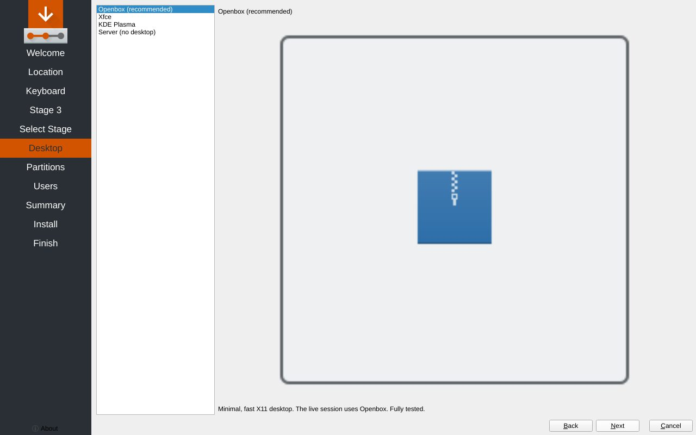
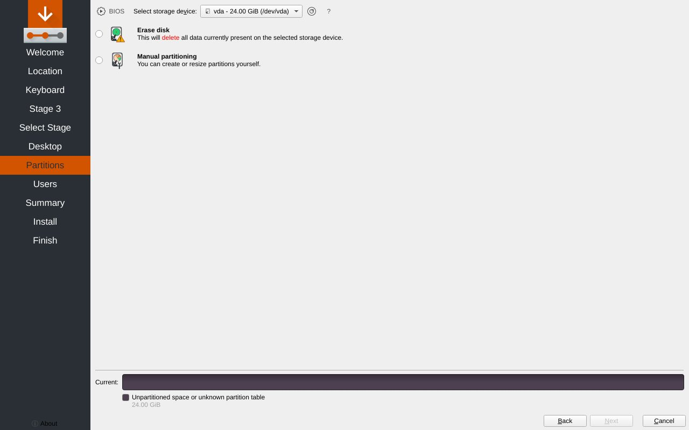
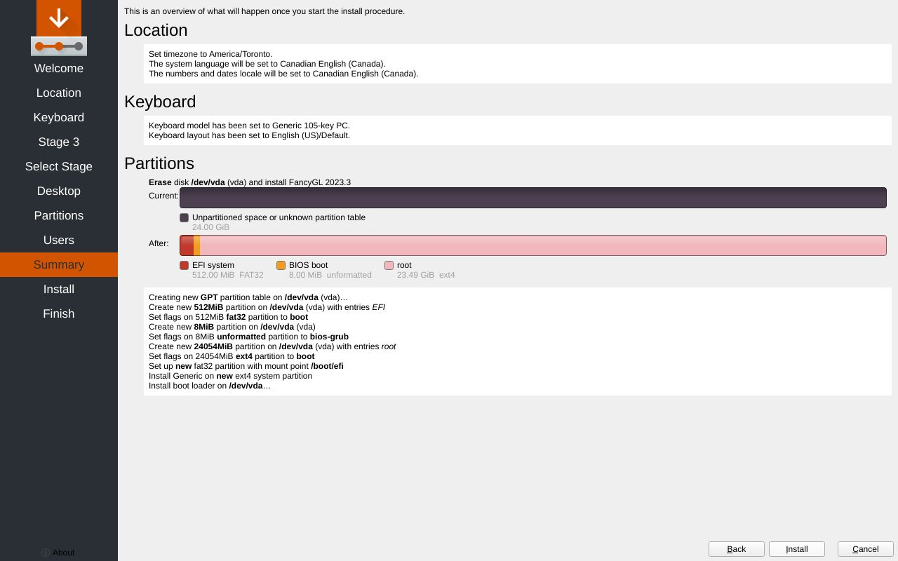

# Installing Ember Linux

This is the full walkthrough for the reference developer-preview ISO. It
describes the path that has passed QA: **Openbox, ext4, erase disk, BIOS or
UEFI, online install**.

> **The tree is under active rebuild.** The current source offers 13 desktop
> choices, a make.conf editor, branding, and a Live CD (offline) stage option.
> Those additions are newer than the verified image and are marked below where
> they change the flow. Check [NEXT-PHASE.md](../NEXT-PHASE.md) for live status.

> **Read this first.** The installer erases the selected disk. Back up your
> data. Secure Boot must be disabled until the signed chain is verified. Do not
> use untested filesystems or encryption on a system you need to boot.

## 1. Before you start

- A 64-bit x86 machine (amd64) with BIOS or UEFI firmware.
- At least 1 GB RAM and 6 GB free disk space; 4 GB RAM and 20 GB+ recommended.
  The verified test used 4 GB RAM and a 24 GiB disk.
- A working wired or wireless network for a normal online install. The
  installer downloads a stage3 and packages from Gentoo mirrors. A Live CD
  (offline) stage option exists in newer builds but is untested.
- A 4 GB or larger USB stick. The ISO is 3.97 GiB.
- A backup of anything on the target disk.
- Secure Boot disabled in firmware. See [Secure Boot](secure-boot.md) for why.

The current file at `images/ember-live-amd64.iso` is a newer, untested rebuild.
The checksum below belongs to the reference build. Verify whichever image you
actually boot:

```sh
sha256sum images/ember-live-amd64.iso
# expected for the verified 2026-11-25 build:
# 934806c8e93766170a53dfff7aa650e90c391153283c1886720e2d9086d70eed
```

## 2. Write the ISO to USB

Identify the device carefully. `dd` destroys the target device.

```sh
lsblk
sudo dd if=ember-live-amd64.iso of=/dev/sdX bs=4M status=progress oflag=sync
sync
```

Replace `/dev/sdX` with the whole USB device, not a partition such as
`/dev/sdX1`. On Windows, use Rufus in DD mode or balenaEtcher. On macOS, use
`dd` with `rdisk`.

> Development builds are tested in QEMU first. Do not flash removable media
> during development unless you intend to install.

## 3. Boot the live ISO

Open the firmware boot menu and select the USB device. Choose the UEFI entry if
you want a UEFI install, or the legacy/BIOS entry for BIOS. The live
environment starts a graphical session with the Ember installer.

If the machine boots straight to the installed system, re-open the firmware
boot menu; the USB entry may be listed under the device name rather than
"Ember".

If the installer is not already open, start it from the live desktop or run:

```sh
sudo calamares
```

## 4. Welcome

The welcome page checks RAM and internet access against
`https://distfiles.gentoo.org/`. The normal install path needs network access
for the stage3 and packages. A newer Live CD (offline) stage option copies the
live rootfs instead; it is not verified and is not the documented path.

If the check fails, fix networking in the live session first and reopen the
installer. See [Troubleshooting](troubleshooting.md#no-network-in-the-live-session).

## 5. Location and keyboard

Choose your region, timezone, language, and keyboard layout. These are written
to the target and used for the installed system.

The QA build used `America/Toronto`, Canadian English, and the generic 105-key
US layout. Other combinations are offered by Calamares but are not part of the
verified matrix.

## 6. Stage 3

The **Stage 3** page explains the choice:

- **Desktop stage3 — recommended for a desktop.** It already uses the desktop
  profile, so the installer does not need a large profile switch afterward.
- **Minimal stage3 — for a server or custom minimal system.** Switching it to a
  desktop profile later can trigger a large rebuild.

The next page selects the exact tarball.

> **GNOME needs systemd.** If you plan to choose GNOME, select a systemd stage3
> (for example `current-stage3-amd64-desktop-systemd`). The installer refuses
> GNOME on an OpenRC stage3. The verified reference install used OpenRC and did
> not test the systemd path.

> **Live CD (offline) is new and untested.** Newer builds add a Live CD stage
> option that copies the live rootfs instead of downloading. It is not part of
> the verified flow; use the online stage3 unless you are testing it.

### Select Stage

1. Architecture: **64-bit Intel/AMD (amd64)**.
2. Variant: **`current-stage3-amd64-desktop-openrc`** for a desktop install.
   For a server, the current minimal OpenRC stage3 is the appropriate base.
   GNOME requires a **systemd** desktop stage3 instead.
3. Wait for the variant list to refresh; it is fetched from the network.
4. Continue.

The verified run downloaded
`stage3-amd64-desktop-openrc-20261122T164601Z.tar.xz`. The exact filename will
change as Gentoo publishes new stages.

> The normal install is online-first by design. If the stage list is empty, the
> mirror is unreachable; check DNS, proxy, and connectivity. The newer Live CD
> option is untested.

## 7. Desktop



| Choice | Status | Session / display manager |
| --- | --- | --- |
| **Openbox (recommended)** | **Tested on reference ISO** | LightDM + openbox-session |
| Xfce | Offered, QA pending | LightDM + xfce |
| KDE Plasma | Offered, QA pending | **SDDM** + plasmax11 |
| GNOME (systemd) | Offered, conditional, QA pending | **GDM** + gnome |
| Cinnamon | Offered, QA pending | LightDM + cinnamon |
| MATE | Offered, QA pending | LightDM + mate |
| LXQt | Offered, QA pending | LightDM + lxqt |
| i3 (tiling) | Offered, QA pending | LightDM + i3 |
| Sway (Wayland) | Offered, QA pending | greetd + tuigreet |
| Hyprland | **Experimental** | greetd + tuigreet; hyproverlay |
| Fluxbox | Offered, QA pending | LightDM + fluxbox |
| IceWM | Offered, QA pending | LightDM + icewm |
| Server (no desktop) | Offered, QA pending | No display manager |

Openbox is the only desktop with a completed end-to-end test, and that test was
on the reference ISO. The preview pane was empty in the tested build — a known
cosmetic issue, not a sign that the choice is unavailable. Newer builds may ship
preview images.

GNOME is refused on an OpenRC stage3. Go back to Select Stage and choose a
systemd stage3 if you want GNOME. Hyprland adds a third-party overlay and is not
ready for a machine you need to boot.

The selected desktop's package list is added to the same Portage transaction as
the base system. KDE Plasma and GNOME are substantially larger and take longer.
See [Desktops](desktops.md) for the detailed matrix.

## 8. Build configuration

Newer builds include an editable **Build configuration** page that probes the
machine and generates `make.conf` values (CFLAGS, MAKEOPTS, USE, VIDEO_CARDS,
INPUT_DEVICES, and related settings).

> This page is **not present in the 2026-11-25 QA ISO**. It is in the current
> source tree and is not yet part of a verified install. If your build shows
> it, review the generated values before continuing. If it shows a **Secure
> Boot** checkbox, uncheck it until the signed chain is verified; if it does
> not, the installer writes a conservative `make.conf` itself.

## 9. Partitions



The tested path is:

1. Select the target disk.
2. Choose **Erase disk**.
3. Swap: **No swap**.
4. Filesystem: **ext4**.
5. Bootloader: the disk device (`/dev/vda` in the VM).

The installer creates a GPT layout with:

| Partition | Size | Type |
| --- | --- | --- |
| 1 | 512 MiB | EFI System Partition (FAT32, `/boot/efi`) |
| 2 | 8 MiB | BIOS boot (unformatted) |
| 3 | remainder | Linux root (ext4, `/`) |

The 8 MiB BIOS boot partition is created on UEFI installs too because the
hybrid layout is global; UEFI boots from the ESP. On BIOS, GRUB uses the 8 MiB
partition instead of fragile blocklist embedding.

**Not tested:** manual partitioning, dual boot with another OS, btrfs, XFS,
f2fs, LUKS2, LVM, and swap files/partitions. They are selectable, but treat them
as experimental. See [Hardware](hardware.md#storage-and-filesystems).

> Erase disk deletes every partition on the selected device, including other
> operating systems.

## 10. Users

Enter:

- full name;
- login name (lowercase, no spaces);
- hostname;
- password, twice.

"Use the same password for the administrator account" is enabled by default in
the tested path. The user is added to `wheel`, so `sudo` works after install.

The QA run used `Gentoo User` / `gentoo` / `gentoo-test`. Do not reuse test
credentials on a real machine.

## 11. Summary and install



Review the summary, then choose **Install**. The current summary recaps
location, keyboard, and partitions only; it does **not** show the Stage 3 or
desktop selection. Confirm those on the earlier pages before starting.

The install runs a package transaction, writes `make.conf`, configures
LightDM/OpenRC, builds the initramfs, installs GRUB, and runs a post-install
verification script. The Openbox VM install took roughly 18 minutes on the QA
host; KDE Plasma will take longer. Download speed and mirror load dominate.

Do not interrupt the install. If a job fails, the installer reports it and
writes details to the Calamares log.

## 12. Finish and first boot

When the installer reports success, reboot and remove the USB stick. The
installed system boots GRUB, then the kernel, then LightDM.

- **Openbox:** log in with the user created during install. The tint2 panel,
  picom compositor, desktop menu, rofi, and xterm should be available. Newer
  builds also install the Ember wallpaper, GTK theme, icons, and greeter theme;
  the verified reference ISO used the stock Gentoo wallpaper.
- **Server:** log in at the console.

On UEFI, `efibootmgr -v` should show an EFI boot entry pointing at the ESP GRUB
image. The reference build used the stock `FancyGL` label; newer branding may
change it. On BIOS, GRUB is installed to the disk's BIOS boot partition.

### Check the install report

```sh
cat /var/log/ember-install-report.txt
```

The report checks the kernel image, GRUB configuration, root entry in `fstab`,
machine-id, home directory, display manager (when installed), Openbox
autostart, `make.conf`, block devices, and EFI boot entries. A failed critical
check makes the installer fail rather than silently claiming success.

## 13. After install

The installed system is ordinary Gentoo. Update it with Portage:

```sh
sudo emerge --sync
sudo emerge --ask --update --deep --newuse @world
```

The installer enables `FEATURES=getbinpkg` and a Gentoo binary package host in
the verified build, so many updates can be fetched as binaries. If you change
`USE` flags, expect source builds.

Useful checks:

```sh
rc-status default          # OpenRC services
ping -c1 9.9.9.9           # networking
efibootmgr -v              # UEFI boot entries (UEFI only)
lsblk -f                   # filesystems and mounts
```

## Known limitations of this preview

- Secure Boot is unverified and must stay off.
- Only Openbox on the reference ISO has completed desktop QA. The newer build
  and every other desktop are offered but unverified.
- Only ext4 has passed filesystem QA.
- BIOS and UEFI pass in QEMU; real hardware is untested.
- Wi-Fi, Bluetooth, NVIDIA proprietary drivers, NVMe, and USB boot are
  untested.
- The make.conf editor, offline Live CD, branding, and Secure Boot pages are
  newer than the verified ISO.
- The desktop chooser preview pane, slideshow copy, and summary recap are
  cosmetic gaps tracked in the [roadmap](roadmap.md).

If something goes wrong, see [Troubleshooting](troubleshooting.md) and open an
**Install report** issue with the exact ISO checksum and firmware mode.
